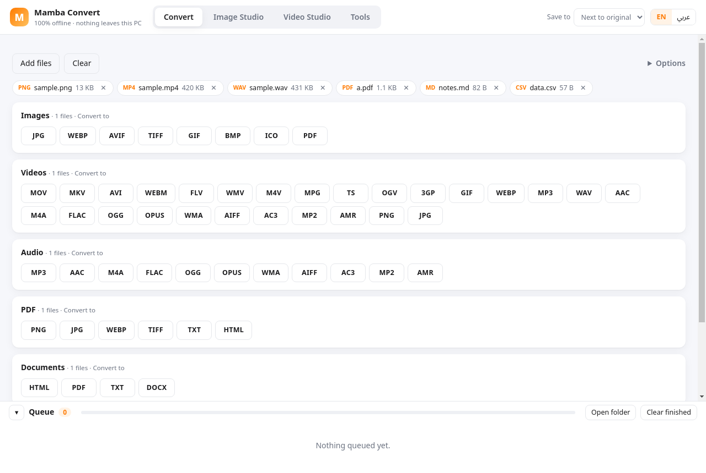
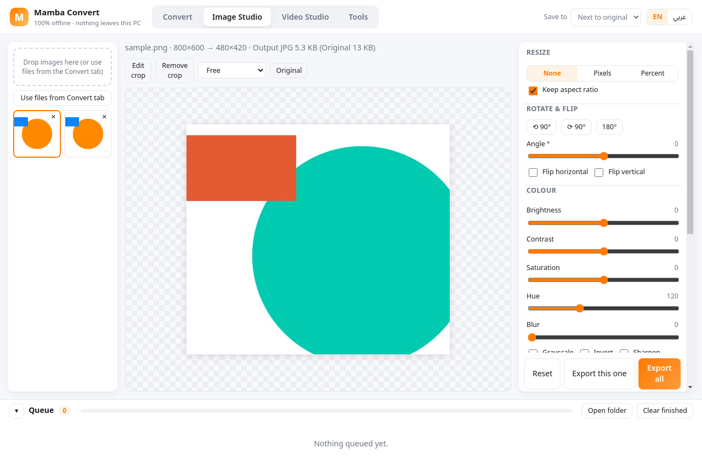
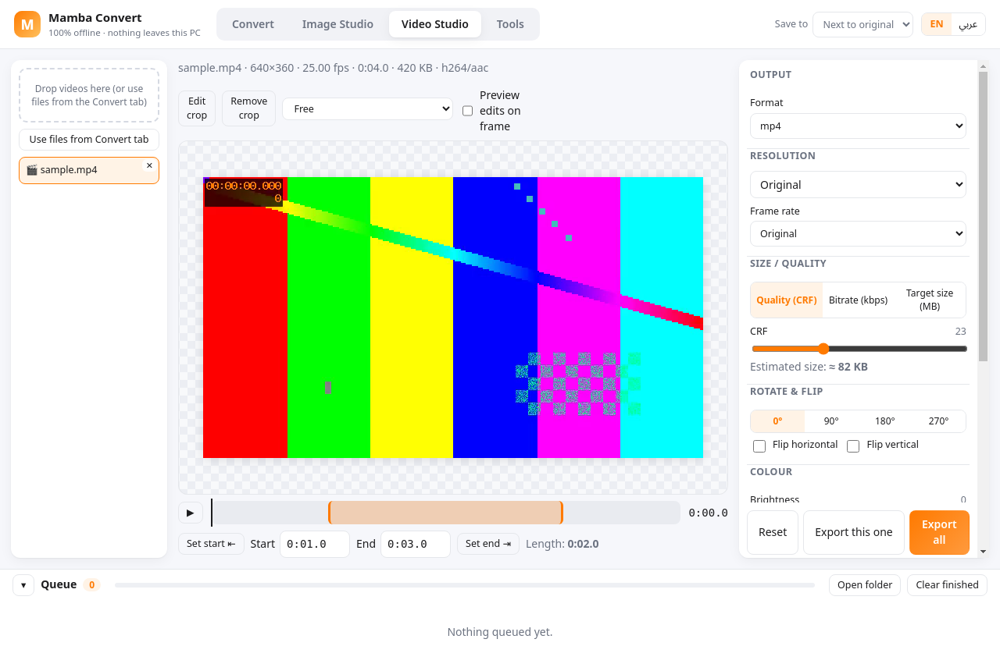
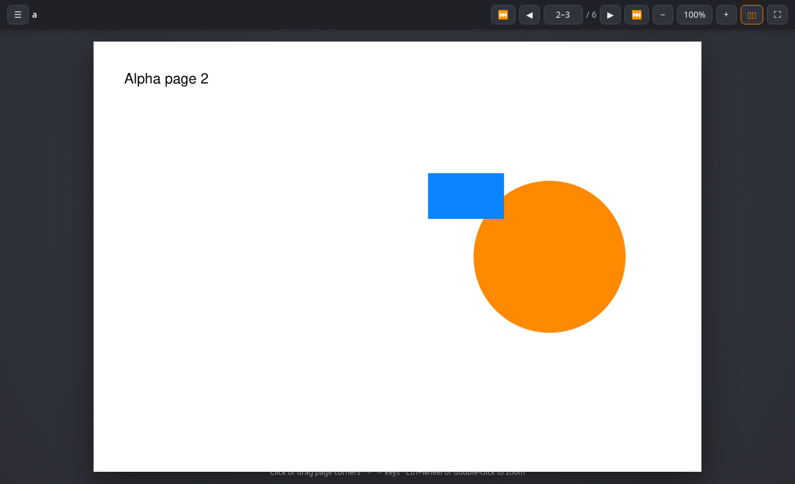

# Mamba Convert

A free, **100 % offline** file converter and toolbox for Windows, built for Ammar and inspired by Tangerine for Mac.
Everything runs locally: FFmpeg, libvips (sharp), MuPDF and pdf-lib are bundled. The app blocks every network request, so no file ever leaves the PC.



## Features
- A big drag-and-drop zone that takes many files and whole folders. The file type is detected automatically, and only valid target formats are shown as buttons.
- **Batch queue** with per-job progress, cancel/retry, *Show* / *Open*, and *Open folder*. Two jobs run in parallel by default.
- Output goes **next to the original** or to a **chosen folder**. Existing files are never overwritten (`name (1).ext`).
- **Image Studio** has a live preview with the real output size, and a press-and-hold *Original* comparison. It covers:
  - Resize by exact pixels or percent, with keep-aspect, fit, cover and pad options.
  - Drag-to-crop with aspect presets.
  - Rotate 90° or any free angle, and flip horizontally or vertically.
  - Brightness, contrast, saturation, hue, blur, sharpen, grayscale and invert.
  - DPI, a quality slider, a **target file size (KB)**, and metadata stripping.
  - Offline background removal (flood fill from the edges, for plain backgrounds).
  - Batch apply to all images. The crop is stored as fractions, so it fits images of any size.
- **Video Studio** has a player with a trim timeline (set start/end at the playhead) and drag-to-crop on the video. You can preview your edits on any frame. It covers:
  - Resolution presets from 240p to 4K, or a custom size.
  - FPS, CRF, a bitrate, or a **target size in MB** (2-pass).
  - Rotate/flip, colour adjustments, mute, loudness normalization and speed.
  - Output to GIF/WebP, or to audio formats.
  - Batch apply, with a separate trim for each file.
- **Make flipbook** (new in 1.1): PDFs, images, documents (md/html/txt/docx) and e-books → a self-contained **offline HTML flipbook**. Output is a single `.html` file or a folder with `index.html` + `pages/`. It has a page-flip animation (click or drag the corners), a thumbnails sidebar, zoom (Ctrl+wheel, double-click, +/−) with panning, single or double page view, full screen, keyboard navigation and right-to-left books. Open it by double-clicking in any browser; no internet is needed.
  The flip engine is `src/flipbook/flip-engine.{js,css}`, with no dependencies, and is meant to be shared with Mamba Reader.
  Finished flipbooks have an **Open in Mamba Reader** button. It works when Reader is found as an installed exe (`%LOCALAPPDATA%\Programs\Mamba Reader\Mamba Reader.exe`, Program Files, or `MAMBA_READER_PATH`), or as a registered `mamba-reader://` (or `reader://`) protocol. The protocol handoff is `mamba-reader://open?path=<file>`.
- **Tools tab** with 31 batch tools (listed below).
- English UI plus **Arabic UI (RTL)**. Light theme.





## Supported conversions
There are 961 input→output pairs, or 875 unique ones when aliases such as jpeg/jpg are counted once.

| Kind | Inputs | Outputs |
|---|---|---|
| Images | png, jpg, jpeg, jfif, webp, avif, tif, tiff, gif, bmp, heic, heif, svg, ico, tga, jp2, ppm, pgm, pcx | jpg, webp, avif, tiff, gif, bmp, ico, pdf, png, mp4, webm, flipbook |
| Videos | mp4, mov, mkv, avi, webm, flv, wmv, m4v, mpg, mpeg, 3gp, ts, mts, m2ts, ogv, vob, f4v, asf | mov, mkv, avi, webm, flv, wmv, m4v, mpg, ts, ogv, 3gp, gif, webp, mp3, wav, aac, m4a, flac, ogg, opus, wma, aiff, ac3, mp2, amr, png, jpg, mp4 |
| Audio | mp3, wav, aac, m4a, flac, ogg, oga, opus, wma, aiff, aif, amr, ac3, mka, caf, m4b, wv, mp2, au | wav, aac, m4a, flac, ogg, opus, wma, aiff, ac3, mp2, amr, mp3 |
| PDF | pdf | png, jpg, webp, tiff, txt, html, flipbook |
| E-books / XPS | epub, xps, oxps, cbz, fb2, mobi | pdf, png, jpg, txt, flipbook |
| Documents | md, markdown, html, htm, txt, docx | html, pdf, txt, docx, md, flipbook |
| Data | csv, tsv, json | json, tsv, html, csv |

## Tools
- 📖 **Make flipbook** — accepts pdf/image/doc/ebook (combines several files into one book)
- 🗜️ **Compress image** — accepts image
- 🎬 **Compress video** — accepts video
- 🎧 **Compress audio** — accepts audio
- 📉 **Compress PDF** — accepts pdf
- ✂️ **Trim audio / video** — accepts video/audio
- 📑 **Merge PDFs** — accepts pdf/image
- 🎼 **Merge audio** — accepts audio/video
- 🎞️ **Merge videos** — accepts video
- 🖼️ **Images → PDF** — accepts image
- 🔪 **Split PDF** — accepts pdf
- 📄 **Extract PDF pages** — accepts pdf
- 🔄 **Rotate PDF pages** — accepts pdf
- 🧩 **PDF → images** — accepts pdf/ebook
- 🔤 **PDF → text** — accepts pdf/ebook
- 🔢 **Add page numbers** — accepts pdf
- 🔒 **Password-protect PDF** — accepts pdf
- 📐 **Resize image** — accepts image
- ↻ **Rotate / flip image** — accepts image
- 🪄 **Remove background** — accepts image
- 🔃 **Rotate / flip video** — accepts video
- 🎵 **Extract audio** — accepts video
- 🌀 **Video → GIF** — accepts video
- 🖥️ **Change resolution** — accepts video
- 📶 **Change bitrate** — accepts video/audio
- ⏱️ **Change frame rate** — accepts video
- ⏩ **Change speed** — accepts video/audio
- 🔇 **Mute video** — accepts video
- 🔊 **Normalize / volume** — accepts audio/video
- 📸 **Video thumbnail** — accepts video
- 🧹 **Strip metadata** — accepts image/video/audio/pdf
## Install (Windows 10/11 x64)
1. Download `MambaConvert-Setup-<ver>-x64.exe` (installer), `MambaConvert-Portable-<ver>-x64.exe` (no install), or the `.zip`, from Releases.
2. The app is not code-signed, so Windows SmartScreen may say *"Windows protected your PC"*. Click **More info → Run anyway**.
3. With the installer, pick a folder and finish. Shortcuts go to the Start menu and the desktop.
4. Optional check: run `"Mamba Convert.exe" --self-test` for a quick built-in test of the converters.

## Build
```bash
npm ci
# put ffmpeg.exe + ffprobe.exe in vendor/ffmpeg-win/ (gyan.dev essentials build)
# put the @img/sharp-win32-x64 package in vendor/sharp-win32-x64/
npx electron-builder --win --x64      # works on Linux too, without wine (icon is embedded with resedit)
node test/run-tests.js                 # engine tests (uses system ffmpeg on Linux)
```
CI: `.github/workflows/build-windows.yml` builds on `windows-latest`, runs the engine tests and a packaged-app smoke test, and publishes a Release for `v*` tags.

## Known gaps
- DOCX → PDF uses mammoth → HTML → Chromium PDF. Basic formatting carries over, but it is not a pixel-perfect Word layout. There is no Office/LibreOffice.
- Background removal is a colour-key flood fill, not AI. It works well for solid or studio backgrounds only.
- PDF *lossless* compression only re-optimizes streams. *Strong* compression rasterizes pages to images, so text is no longer selectable.
- No RAW camera formats, PSD, or animated-image editing in Image Studio (only the first frame is edited).
- Unsigned build, so SmartScreen shows a warning.

Licenses: FFmpeg (GPLv3 build from gyan.dev), MuPDF (AGPL), libvips (LGPL), pdf-lib (MIT), Electron (MIT). Free for personal use.
